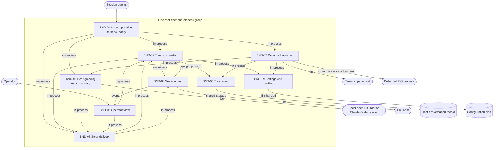

# Structure

Pig Litter is an extension that the released PiG host loads for a root session. Its logical boundaries are modules inside one extension, so this file uses a module diagram instead of containers. One instance of these modules serves one root tree. A detached session is another PiG process with its own instance.

The [boundary records](boundaries.yaml) hold each module's responsibility, inputs, outputs, and edges.

## Reading the diagram

- **One tree is one failure unit.** The root, the extension, and every dependent child end together. Only the tree record and each session's stored conversation outlive the process.
- **Two trust boundaries.** Agent operations decides what an agent may do to another session. The peer gateway is where input from outside the tree arrives.
- **One way in for content.** Every input that reaches a session's conversation passes through steer delivery, which labels it with its origin.
- **One seam for running sessions.** Only the session host creates, drives, and observes sessions on the released PiG host. The tree record uses the host's conversation storage, and the operator view uses the host's drawing surface. The technical specification decides whether those two uses go through the same seam.
- **Dependent children add no boundary.** A child at any depth calls the same agent operations and is hosted by the same session host.
