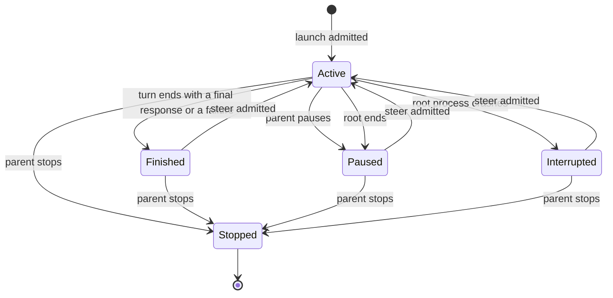

# Check and control a direct child

A parent checks the state of its direct child, pauses it, or stops it, without seeing the child's private work.

## Rules

- Agent operations accepts a state query, a pause, or a stop only from the child's immediate parent. The answer is a state, never conversation content.
- A pause ends the child's current turn and leaves its descendants running. A handback from one of them wakes the paused child like any other steer.
- A plain stop on a child with descendants is refused with a warning that states how many sessions would stop. The parent repeats the stop with an explicit acknowledgement of the cascade, or passes the acknowledgement on the first call.
- A stopped child is unavailable for messaging. Its former parent can still learn that it is stopped for as long as the tree exists.
- A session that is inactive but has an active child still holds a slot.

## Failure path

- **A session other than the immediate parent calls.** The operation is rejected, and the rejection doesn't reveal the child's state.
- **A stop arrives mid-turn.** The parent gets a status that the child was stopped mid-turn. No handback is produced.
- **The child's turn won't end when asked.** The tree coordinator keeps the child's slot until the session host confirms the turn has ended, so capacity is never counted as free too early.
- **The subtree changes between the warning and the acknowledged stop.** The stop applies to the subtree as it is when the acknowledged call arrives.
