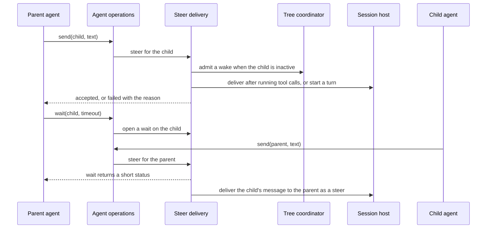

# Coordinate nested work and wait for a child

A parent whose child has delegated further coordinates by message and holds its turn open until a needed child responds.

## Rules

- A session messages only its direct children and its own parent. Any session below the depth limit whose profile isn't read-only can launch its own children.
- A session holds a slot while its turn is open, including a turn blocked in a wait, and while any of its children is active.
- Waking a session also admits each of its inactive ancestors. The tree coordinator admits all of them or rejects the wake.
- A wait selects one direct child and needs a timeout no greater than the configured maximum. A message from that child or its handback ends the wait. The content always arrives through the steer.
- Steers from other senders stay pending while the wait is open and take effect after it returns.

## Failure path

- **The wait reaches its timeout.** It returns the timeout status and the child keeps working.
- **The selected child crashes or is fully stopped.** The wait returns the failure at once.
- **The selected child is inactive and has no active children.** The wait returns at once and says so.
- **The waiting session is paused or the operator interrupts its turn.** The wait ends with the turn. The child is unaffected, and its later handback arrives as a steer.
- **A wake can't get slots for the session and its inactive ancestors.** The send fails with the capacity error and the message is discarded.
- **The recipient's pending steers have reached their bound.** The send fails as recipient busy. A handback is exempt and is always kept.
