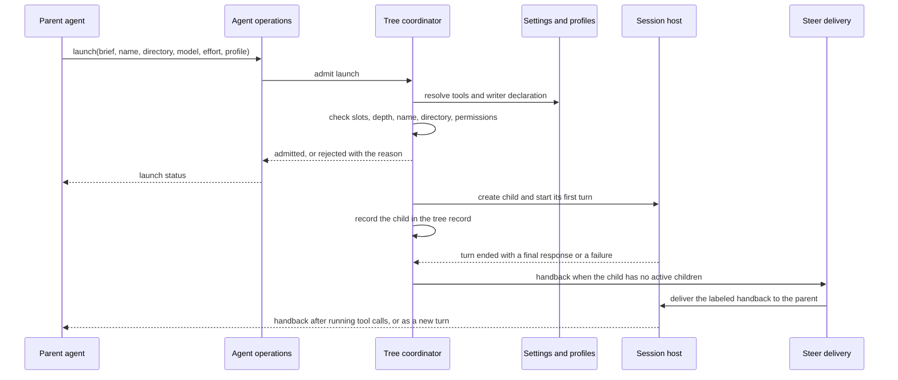

# Delegate work to a dependent child

A parent gives a fresh dependent child a bounded assignment, keeps working, and continues with the child's response.

## Rules

- The launch call answers before the child does any work. Every problem that can be checked before the child exists is a rejection of the call.
- The child's tools are the parent's permissions narrowed by the profile. The profile declares whether the role writes.
- The parent already holds a slot while its child is active, so the handback wakes an idle or paused parent without a new admission.
- A handback is delivered whole and carries the child as its origin.

## Failure path

- **The launch is rejected.** The parent gets the reason in the launch status and no child exists.
- **The child's first turn can't start or its turn fails.** The tree coordinator marks the child finished and the parent receives a failure handback. The child stays reachable, so the parent can message it to try again.
- **The child finishes while it has active children.** No handback is sent. The child's own children wake it later, and the handback follows the turn in which it has none active.
- **The root's process ends before the handback.** The tree record restores the child as interrupted, and the parent receives the recovery notice described in the halt and recovery flow.
