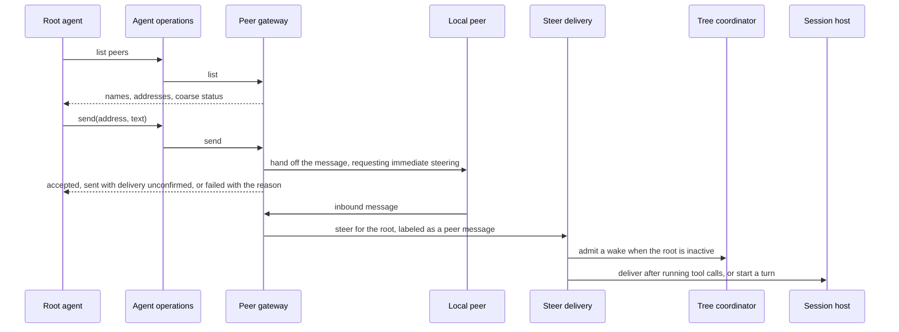

# Exchange messages with a local peer

A root finds another local root or Claude Code session, sends it a message, and receives messages, while each session carries on with its own work.

## Rules

- Only the root takes part. A dependent child can't list peers, send to them, or be reached by them.
- A send does the hand-off and returns at once. It never waits for the recipient to read or act.
- When only the write to a Claude Code peer is known, the outcome is sent with delivery unconfirmed.
- The operating-system account is the trust boundary. An inbound message is labeled as a peer message and grants no tools.
- The peer switch in the tree's settings turns the gateway off. The root is then neither listed nor reachable.

## Failure path

- **The peer is gone or the hand-off can't complete promptly.** The send fails with the reason. Pig Litter doesn't retry.
- **The message exceeds the size limit.** The send is rejected and states the limit.
- **An inbound message would wake an inactive root in a tree at capacity.** The wake is rejected, the message is discarded, and the sender is told.
- **The root's pending steers have reached their bound.** The inbound message is refused as recipient busy.
- **An inbound message can't be understood.** The exchange fails on the sender's side. The root's conversation is unaffected.
- **The Claude Code peer holds or refuses the message under its own inbound controls.** Pig Litter reports what the protocol returns and states the known limitation.
- **A Claude Code release changes the protocol.** Peer messaging fails, including between PiG roots. The risks file records this dependency.
