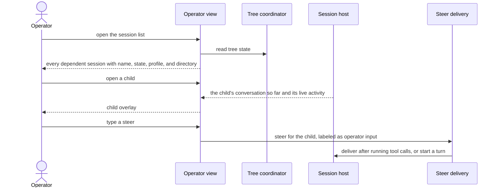

# Follow and steer a child from the root's view

In interactive PiG, the operator finds a dependent child in the root's view, opens its conversation, follows it live, and steers it.

## Rules

- The operator can open any dependent session in the tree at any depth. Detached sessions that the root launched appear in a separate group with only their name, address, and coarse status.
- The overlay offers follow and steer. It states that pause, stop, and interrupting the child's turn aren't available from it, and it states any other interaction the released host can't support.
- The child's parent isn't told that the operator steered it.
- Conversation content reaches only the operator view. No agent operation reads it.

## Failure path

- **The steer would wake an inactive child in a tree at capacity.** The overlay shows the capacity error and the steer is discarded.
- **The child is fully stopped while its overlay is open.** The overlay shows the stopped state and refuses further steers.
- **The run has no terminal view.** The operator view doesn't exist, and orchestration works without it.
- **The released host can't give the overlay the full view.** The overlay uses the largest area the host allows and says so.
