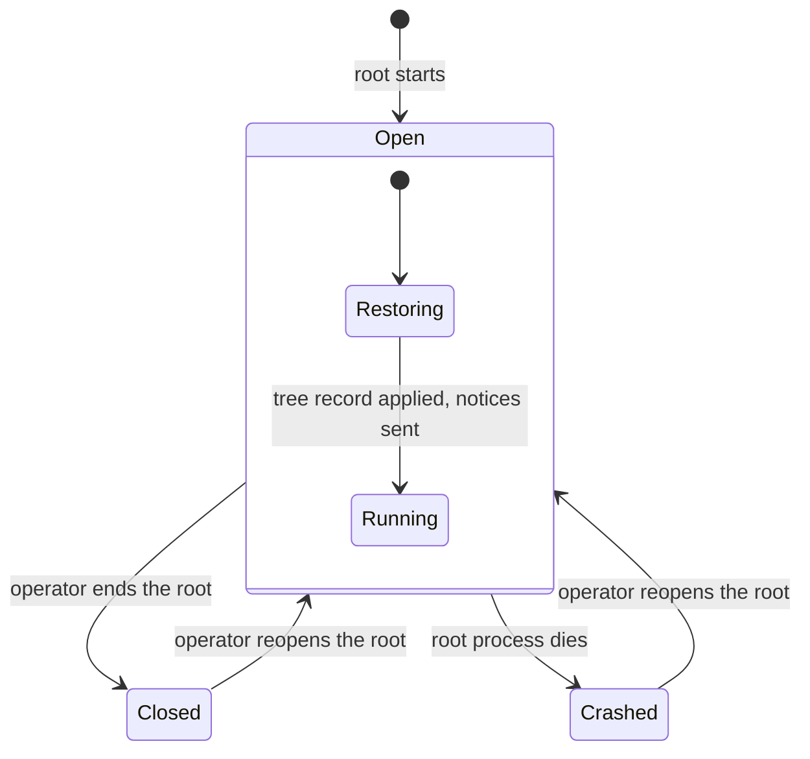

# Halt a tree and recover interrupted work

The operator halts everything a root owns by ending the root, brings it back by reopening the root, and learns which work a crash interrupted.

## Rules

- Every dependent child lives in the root's process. Ending the root ends every live turn in the tree, and the tree record keeps each session's membership, parent, name, directory, profile, and state.
- While the root is closed or crashed, the peer gateway is down. Nothing in the tree is listed or reachable, and a send to the root fails.
- On reopen after an orderly end, sessions that were active come back paused. On reopen after a crash, sessions that were active come back interrupted.
- After a crash, each parent of an interrupted child receives a labeled notice from Pig Litter that names those children. The notice travels through steer delivery in interactive and headless runs.
- Nothing resumes by itself. A steer from its parent wakes a restored child in the same conversation, subject to admission.
- To stop work for good, the operator tells the root to stop its children.

## Failure path

- **The root runs without a persisted conversation.** No tree record exists, and the tree is lost when the root ends. Pig Litter states this limitation when such a root first launches a child.
- **The tree record's last write is older than the crash.** A session launched after that write is absent from the restored tree. Its conversation remains with the host and isn't reachable through Pig Litter.
- **A child's stored conversation can't be reopened.** The child is restored as interrupted, and a steer to it fails with the reason.
- **A steer accepted before the crash wasn't delivered.** It is lost. The sender was told only that it was accepted.
