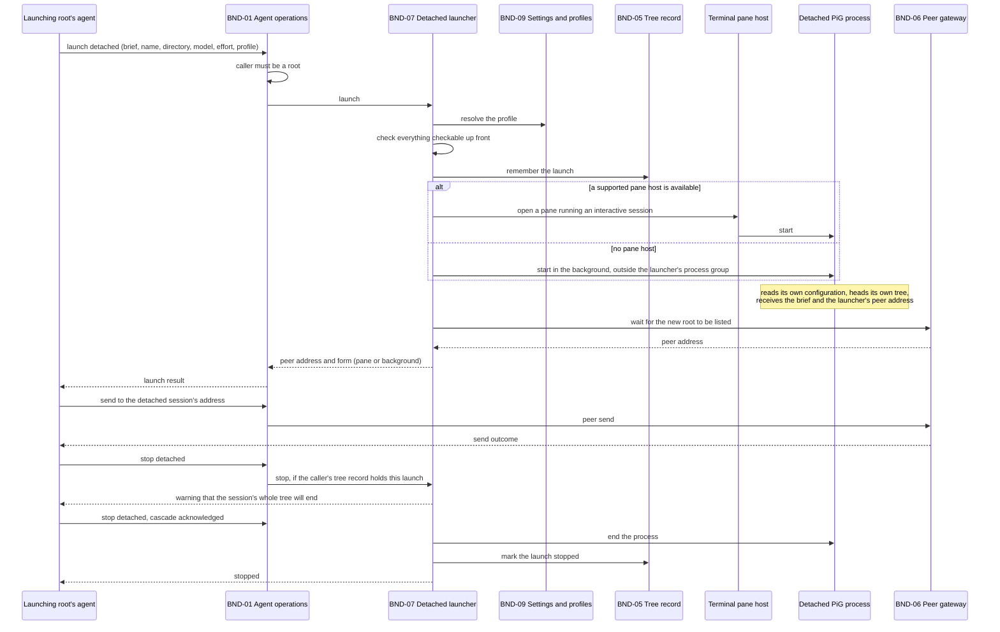

# Launch, message, and end a detached session

A root starts an independent session for a larger piece of work. The new session is a root of its own tree in its own process. The two coordinate as peers, and the launcher alone can stop it through Pig Litter.

## Rules

- Agent operations accepts a detached launch only from a root. A dependent child's call is rejected with the reason.
- The detached session is an ordinary root. It reads its own user-level and project configuration from its own working directory, takes its own limits and permissions, and can launch dependent children and detached sessions of its own. Nothing of the launcher's limits or permissions carries over.
- The launch gives the detached session its brief and its launcher's peer address as its first input.
- Where a supported pane host is available, the session opens in a pane as an interactive session. Otherwise it runs in the background. The launch result states which form was used.
- A background session starts outside the launcher's process group with no shared input or output, so the launcher's exit or crash doesn't end it. Between turns it holds its run open and stays listed as a peer.
- After the launch, the launcher and the detached session are peers. They exchange messages through the peer gateway under the rules of the [peer messaging flow](exchange-peer-messages.md). The launcher can't wait on the detached session, query its state, or pause it.
- The launcher's tree record remembers each launch. After the launcher restarts and its tree is restored, it can still stop the sessions it launched.
- A stop ends the detached session's whole tree. The first call returns a warning, and the stop takes effect when the launcher repeats it with the cascade acknowledged or passes the acknowledgement on the first call. The launcher can't see inside the other tree, so the warning doesn't state a count.
- A detached session never ends by itself. It runs until its launcher stops it or the operator ends it.

## Failure path

- **A dependent child calls detached launch.** The call is rejected. The child can launch only dependent children.
- **A checkable input is wrong.** An unknown profile, a missing directory, a name already used in the launcher's tree, or an unavailable model rejects the launch with the reason before any process starts.
- **The pane host fails to open a pane.** The launcher falls back to the background form and the result says so.
- **The new process doesn't become listed.** The launch fails with the reason, and the launcher ends the process it started and removes the record of the launch.
- **Peer messaging is switched off for the launcher.** The detached launch is rejected, because the two could never coordinate.
- **The launcher ends or crashes.** The detached session keeps running. Its messages to the launcher fail as sends to an unreachable peer until the launcher returns.
- **The detached session crashes.** It becomes unreachable. The launcher learns of it from the outcome of its next send. Pig Litter doesn't restart it.
- **A session other than the launcher asks to stop it.** The stop is rejected. Any peer can still message the session.
- **A stop targets a session that has already ended.** The launcher marks the launch stopped and reports that the session was already gone.
