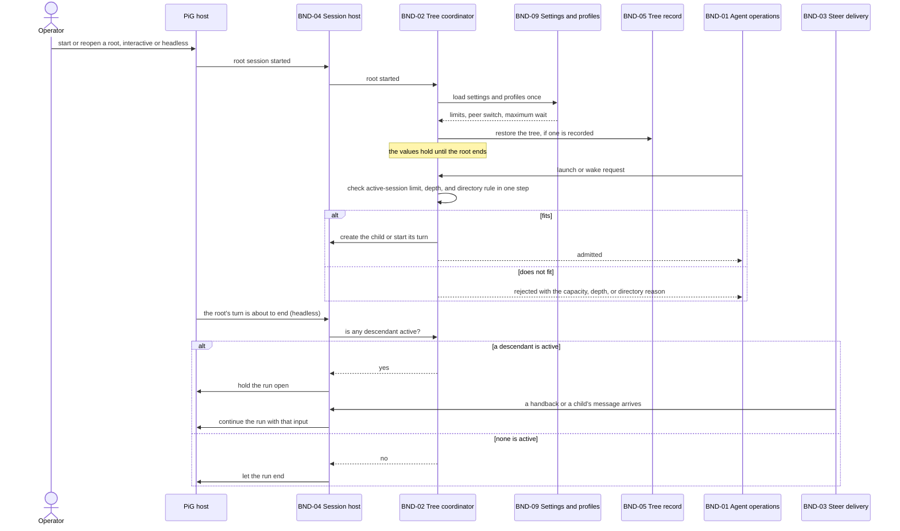

# Run a constrained tree on an unmodified host

The operator starts a root on a released PiG host, interactive or headless. The root's configured limits hold for the whole tree, and a headless root stays running until its descendants are done.

## Rules

- Settings and profiles loads the user-level and root-project files once, when the root starts or is reopened. A change to a file takes effect at the next root start.
- The tree coordinator makes every admission decision in one serialized step that checks the active-session limit, the delegation depth, and the working-directory rule together.
- A session holds a slot while its own turn is open, including a turn blocked in a wait, or while any of its children is active. The root counts under the same rule.
- The directory rule compares the working directories of write-capable dependent children in the tree. Two of them can be neither equal nor nested. The root and read-only children are exempt.
- A headless root's run is held open at the end of each turn while any descendant is active. A handback or a child's message continues the run in the same conversation. When no descendant is active, the run ends normally.
- Detached sessions aren't descendants. They don't keep a headless root running, by the owner's ruling.
- The session host is the only boundary that touches the host. When the released host can't support an interaction, the session host states the limit and the operation's result carries the statement.

## Stated host limits

SPK-PL-OD001 found these on the released host. The session host states each one where it applies.

- A headless run's printed output carries only the root's final response. Earlier responses stay in the stored conversation.
- The decision to hold a headless run is made before the turn settles. Nothing can restart a headless root after its run has ended.
- A held headless run ends if Pig Litter's own process ends. The host's documentation says an aborted run also skips the hold. The spike didn't measure that case.
- Pig Litter must leave the host's own process group to start anything that outlives the root, because the host ends that whole group when it shuts down.

## Failure path

- **A launch or wake exceeds a limit.** The request is rejected at once with one wording per reason, the same for launches and wakes. Nothing is queued.
- **Two requests compete for the last slot.** The tree coordinator serializes them. One is admitted, and the other gets the capacity rejection.
- **A settings or profile file exists and can't be read.** The root's first Pig Litter operation fails with the reason. Pig Litter doesn't fall back to defaults.
- **The root has no stored conversation.** The tree works for the life of the process and can't be restored. Pig Litter states this when the root first launches a child.
- **A headless root is aborted or killed while it holds.** The tree ends with it. On reopen, sessions that were active restore as interrupted, as in the [halt and recover flow](halt-and-recover-tree.md).
- **The host lacks an interaction the design needs.** The session host reports the limit in the operation's result, and the operation fails or degrades as the limit's statement says. It never fails silently.
