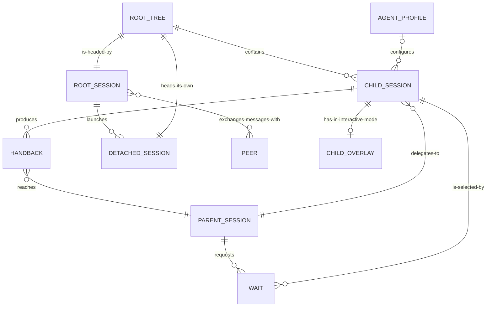

# Domain model

A root tree has one root session and its dependent children, and each child has one immediate parent. Parent authority follows the delegation relationship. Roots are peers of one another and of local Claude Code sessions. A peer relationship provides addressing and coarse status. A root that launches a detached session is that session's launcher, which adds the authority to stop it.

## Session lifecycle

Launch creates a fresh session with an explicit brief and its own conversation. A session is active during its turn, including while a wait holds the turn open, and while any of its children is active. The active sessions of a root tree share a concurrency limit.

Pausing interrupts a child's work while its descendants continue. When a child finishes its turn, it remains reachable. A steer wakes a paused, finished, or interrupted child in the same conversation if admission permits. Stopping ends the child's availability and can stop its descendants after the parent receives a warning.

Ending the root halts all live work in its tree, and nothing in the tree is reachable while the root is closed. Reopening the root makes its children reachable again. A crash of the root's process interrupts the live work in the same way, and Pig Litter reports the interrupted children to their parents when the root returns.

A detached session has its own lifecycle. It keeps running after its launcher ends and stays reachable while idle. It ends when its launcher stops it or the operator ends it. If it crashes, it becomes unreachable until the operator reopens it.

## Message and result delivery

Inside a tree, a session messages only its direct children and its own parent. Roots message their peers. A send returns its outcome at once and never waits for the recipient to read.

A steer reaches an active session after running tool calls finish. It can begin a turn in an inactive session. A child's final response or failure becomes a handback when the finishing child has no active children. The handback reaches only the immediate parent through the same steer mechanism, and it wakes the parent even when the parent is paused.

A wait selects one direct child and requires a timeout. A message from that child to its parent or a handback ends the wait and delivers the content through a steer. The tool returns a short status. A crash or stop ends the wait with failure. A wait on an inactive child returns at once. Other steers can take effect after the wait returns.

A detached session produces no handback and can't be the subject of a wait. It reports to its launcher by peer message.

## Visibility and control

Roots can discover one another and see coarse status when available. Dependent children are hidden from every session outside their tree. The immediate parent can check its child's state and can pause or stop it. In the terminal user interface, the operator can follow or steer any dependent child's conversation through the child overlay. Agent-facing operations keep other sessions' traces private.
