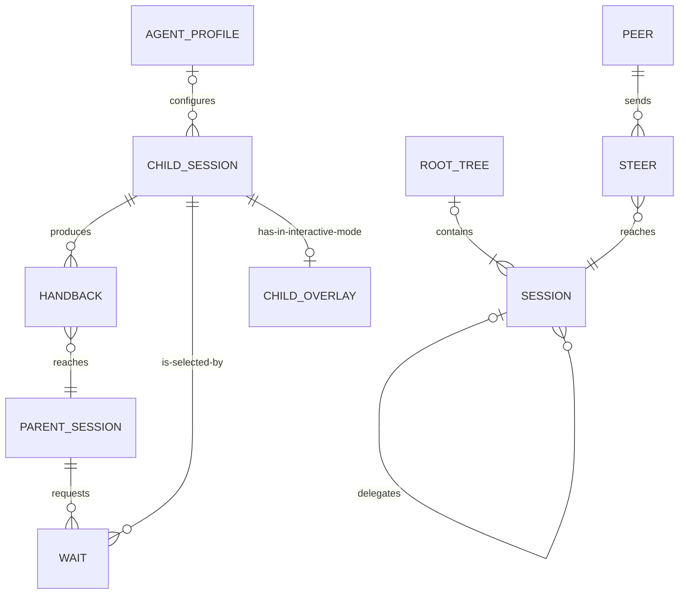

# Domain model

A session can participate in a delegation tree, local peer messaging, or both. Each tree has one root session and each child has one immediate parent. A peer relationship provides addressing and coarse status. Parent authority follows the delegation relationship.

## Session lifecycle

Launch creates a fresh child with an explicit brief and its own conversation. A session is active during its turn, including while a wait holds the turn open. The root and its active descendants share a concurrency limit.

Pausing interrupts the child's work while its descendants continue. When a child finishes its turn, it remains reachable. A peer steer wakes a paused or finished child in the same conversation if admission permits. Stopping ends the child's availability and can stop its descendants after the parent receives a warning. A parent process crash can interrupt the live work. Pig Litter reports the interruption when the parent returns.

## Message and result delivery

A steer reaches an active session after running tool calls finish. It can begin a turn in an inactive session. A final response becomes a handback when the finishing child has no active children. The handback reaches only the immediate parent through the same steer mechanism.

A wait selects one direct child and requires a timeout. An explicit message from that child to its parent or an eligible handback ends the wait and delivers the content through a steer. The tool returns a short status. A crash or stop ends the wait with failure. Other steers can take effect after the wait returns.

## Visibility and control

Peers can discover a session and see its coarse status when available. The immediate parent can check whether its child is active and can pause or stop it. In the terminal user interface, the operator can follow or steer the child's conversation through the child overlay. Agent-facing operations keep other sessions' traces private.
